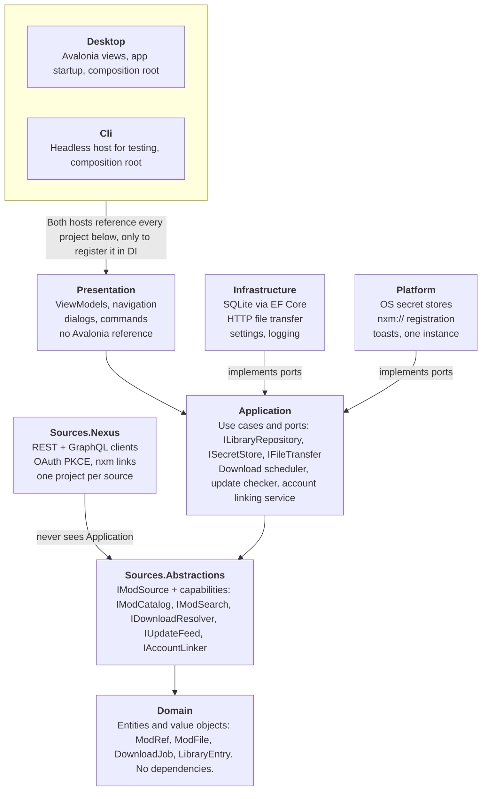

# ModHub — Implementation Plan

Oct 20, 2026 · @Jean

> Markdown version of `ModHub — Implementation Plan.pdf`, converted on Oct 23, 2026 with the wording unchanged.
> "ModHub" was the working name; the product is ModShelf, so read every `ModHub` as `ModShelf`.

## Overview & scope

ModHub is a cross-platform desktop app (Avalonia on .NET 10) that downloads mods from multiple sources and tracks their updates in one place. It never installs mods into games. Nexus Mods is the first source, and every layer is built so more sources plug in without touching the core. Target: v1.0 in about 11 weeks for one developer, with Nexus plus one more source.

### In scope for v1

- Link an account per source (Nexus: OAuth 2.0 with PKCE, or a pasted API key)
- Browse, search and download mod files, including the free-user `nxm://` handoff
- Choose where files are saved, with per-game and per-source folder templates
- A local library of downloaded files and watched mods
- Background update checks with notifications and changelogs

### Out of scope, by design

- Installing, extracting or deploying anything into game folders
- Load order, conflict detection, FOMOD installers, collection installs
- Hosting or redistributing mod files

"ModHub" is a working name. Renaming is a find-and-replace during Phase 0, before the first commit.

## Tech stack & key decisions

Target .NET 10 with Avalonia 12. .NET 10 is the current LTS, supported through November 2028; .NET 11 is a shorter-support release shipping November 10, 2026, so it adds risk without extending the support window. Exact package versions get pinned once, in `Directory.Packages.props`, during Phase 0.

| Area | Choice | Why |
|---|---|---|
| Runtime | .NET 10 (`net10.0`), C# 14 | LTS through Nov 2028 ([source](https://www.infoworld.com/article/4191704/end-of-support-looms-for-net-8-and-net-9)) |
| UI | Avalonia 12.1.x | Current stable line, cross-platform Windows/macOS/Linux ([NuGet](https://www.nuget.org/profiles/AvaloniaUI)) |
| MVVM | CommunityToolkit.Mvvm 8.4.x | Source-generated observables and commands, no reflection ([NuGet](https://nuget.org/packages/CommunityToolkit.Mvvm/absoluteLatest)) |
| Composition | Microsoft.Extensions.Hosting + DependencyInjection | One container shared by the UI and a CLI host |
| HTTP | `IHttpClientFactory` + Microsoft.Extensions.Http.Resilience | Retries, timeouts and backoff per source |
| Local data | SQLite via EF Core 10 | Single-file library database with migrations |
| Logging | Microsoft.Extensions.Logging + Serilog file sink | Rolling log files users can attach to bug reports |
| Secrets | `ISecretStore` with per-OS implementations | Windows DPAPI/Credential Manager, macOS Keychain, Linux libsecret |
| Packaging | Velopack | Installers, delta updates and self-update on all three OSes ([docs](https://docs.velopack.io/)) |
| Tests | xUnit v3, NSubstitute, WireMock.Net | Unit tests plus recorded HTTP fakes per source |
| CI | GitHub Actions, matrix of windows / macos / ubuntu | Build, test and package on every push |

**Build rules applied to every project:** nullable reference types on, warnings as errors, .NET analyzers at `latest-recommended`, implicit usings on, deterministic builds.

## Architecture

The solution uses a layered architecture: every dependency points inward toward Domain, and each mod site lives in its own source project that sees only `Sources.Abstractions`. Architecture tests enforce these rules in CI from Phase 0.

**Every arrow points inward; sources plug in through one seam**\
Arrows mean references. Every project name starts with ModHub.



*project dependencies · 7 libraries, 2 hosts*

A source never references Application or Infrastructure, so adding one cannot break the core; only the two hosts know concrete types.

### Dependency rules

| Project | May reference | Never references |
|---|---|---|
| Domain | Nothing | Everything else |
| Sources.Abstractions | Domain | Application, Infrastructure, Platform, any source |
| Application | Domain, Sources.Abstractions | Infrastructure, Platform, any source, Avalonia |
| Sources.Nexus (and every future source) | Sources.Abstractions | Application, Infrastructure, Platform, other sources |
| Infrastructure | Application | Platform, any source, Avalonia |
| Platform | Application | Infrastructure, any source, Avalonia |
| Presentation | Application | Infrastructure, Platform, any source, Avalonia |
| Desktop, Cli | Everything, for DI registration only | — |

Sources get their `HttpClient` through `IHttpClientFactory`, registered by the host, so they never need Infrastructure.

### How SOLID maps onto the solution

- **Single responsibility:** the scheduler orchestrates, `IFileTransfer` moves bytes, and a source only translates one site's API.
- **Open/closed:** a new source is a new project plus one DI registration; no core file changes. Phase 7 measures this.
- **Liskov substitution:** every source passes the same `SourceContractTests<T>`, so the app treats sources interchangeably.
- **Interface segregation:** capabilities are small interfaces; a site without search simply doesn't implement `IModSearch`.
- **Dependency inversion:** Application owns the ports; Infrastructure, Platform and sources implement them.

### Key contracts

```csharp
// ModHub.Sources.Abstractions: a source implements only what its site supports
public interface IModSource
{
    SourceId Id { get; }
    string DisplayName { get; }
}

public interface IModCatalog : IModSource
{
    Task<ModInfo> GetModAsync(ModRef mod, CancellationToken ct);
    Task<IReadOnlyList<ModFile>> GetFilesAsync(ModRef mod, CancellationToken ct);
}

public interface IModSearch : IModSource
{
    Task<SearchPage> SearchAsync(GameRef game, SearchQuery query, CancellationToken ct);
}

public interface IDownloadResolver : IModSource
{
    // A URL + headers + expected hash + expiry, or a handoff request (Nexus free users)
    Task<ResolveResult> ResolveAsync(ModFileRef file, CancellationToken ct);
}

public interface IUpdateFeed : IModSource
{
    Task<IReadOnlyList<ModUpdate>> GetUpdatesAsync(GameRef game, DateTimeOffset since, CancellationToken ct);
}

public interface IAccountLinker : IModSource
{
    IReadOnlyList<IAuthStrategy> Strategies { get; }
}

// ModHub.Application: finds sources by capability
public interface ISourceRegistry
{
    IEnumerable<T> All<T>() where T : IModSource;
    T? Find<T>(SourceId id) where T : class, IModSource;
}
```

## Phase 0 — Repository & solution setup (2–3 days)

Phase 0 ends with an empty Avalonia window that builds and passes tests on Windows, macOS and Linux, pushed as the first commit. No features yet; only structure, rules and CI.

**Day one, outside the code:** register the app with Nexus Mods (contact their support with a test build plan) so approval runs in parallel with development.

1. Install prerequisites: .NET 10 SDK, Avalonia templates (`dotnet new install Avalonia.Templates`), xUnit v3 templates (`dotnet new install xunit.v3.templates`), and Rider, Visual Studio or VS Code with the Avalonia extension.
2. Create the repo and root files:

   ```bash
   mkdir ModHub && cd ModHub
   git init -b main
   dotnet new globaljson --sdk-version 10.0.100 --roll-forward latestFeature
   dotnet new gitignore
   dotnet new editorconfig
   dotnet new sln -n ModHub
   ```

3. Add `.gitattributes` (`* text=auto eol=lf`), `README.md`, `LICENSE`, `CONTRIBUTING.md` and `docs/adr/0001-layered-architecture.md` recording the architecture below.
4. Add `Directory.Build.props` so every project shares the same rules (remove `TargetFramework`, `Nullable` and `ImplicitUsings` from the generated `.csproj` files):

   ```xml
   <Project>
     <PropertyGroup>
       <TargetFramework>net10.0</TargetFramework>
       <LangVersion>latest</LangVersion>
       <Nullable>enable</Nullable>
       <ImplicitUsings>enable</ImplicitUsings>
       <TreatWarningsAsErrors>true</TreatWarningsAsErrors>
       <AnalysisLevel>latest-recommended</AnalysisLevel>
       <EnforceCodeStyleInBuild>true</EnforceCodeStyleInBuild>
       <Deterministic>true</Deterministic>
     </PropertyGroup>
   </Project>
   ```

5. Add `Directory.Packages.props` with `<ManagePackageVersionsCentrally>true</ManagePackageVersionsCentrally>`, so package versions live in one file and projects reference packages without versions.
6. Create the projects:

   ```bash
   # core libraries
   dotnet new classlib -o src/ModHub.Domain
   dotnet new classlib -o src/ModHub.Sources.Abstractions
   dotnet new classlib -o src/ModHub.Application
   dotnet new classlib -o src/ModHub.Infrastructure
   dotnet new classlib -o src/ModHub.Platform
   dotnet new classlib -o src/ModHub.Sources.Nexus
   dotnet new classlib -o src/ModHub.Presentation
   # hosts
   dotnet new avalonia.app -o src/ModHub.Desktop
   dotnet new console -o src/ModHub.Cli
   # tests (one per library, plus architecture rules)
   for p in Domain Application Infrastructure Sources.Nexus Presentation Architecture; do
     dotnet new xunit3 -o tests/ModHub.$p.Tests
   done
   # bash/zsh or Git Bash
   dotnet sln add src/*/*.csproj tests/*/*.csproj
   ```

7. Add project references exactly as the dependency rules in Architecture allow, and nothing more.
8. Write the first architecture tests in `ModHub.Architecture.Tests` (ArchUnitNET or NetArchTest) so a forbidden reference fails the build from day one.
9. Boot `ModHub.Desktop` through a generic host: DI container, logging, an empty shell window and a `MainWindowViewModel` resolved from `ModHub.Presentation`.
10. Add `.github/workflows/ci.yml`: restore, build and test on `windows-latest`, `macos-latest` and `ubuntu-latest` for every push and pull request.
11. Make the first commit and link GitHub:

    ```bash
    git add .
    git commit -m "chore: scaffold layered solution, build rules and CI"
    git remote add origin https://github.com/<you>/ModHub.git
    git push -u origin main
    ```

**Done when:** `dotnet build` and `dotnet test` are green on all three CI runners, and the app opens an empty window on your machine.

## Phase 1 — Core domain & download engine (1.5 weeks)

Phase 1 delivers a resumable download queue that survives restarts, driven from the CLI host with a fake direct-URL source. No real mod site is involved yet, so the engine is proven independently of Nexus.

### Domain (`ModHub.Domain`)

- Value objects: `SourceId`, `GameRef` (source + the source's game key), `ModRef`, `ModFileRef`, `FileHash` (algorithm + value)
- Entities: `ModFile` (name, version label, category, size, upload time, hashes) and `DownloadJob`
- `DownloadJob` is a state machine: Queued → Resolving → AwaitingHandoff → Downloading → Verifying → Completed, with Paused, Failed and Cancelled as exits. Invalid transitions throw, and the domain tests cover every edge.

### Application (`ModHub.Application`)

- `IDownloadQueue` and a `DownloadScheduler` with global and per-source concurrency limits
- Progress published through `System.Threading.Channels`, so the UI and CLI subscribe the same way
- Ports the engine needs: `IFileTransfer`, `IDownloadJobRepository`, `IClock`

### Infrastructure (`ModHub.Infrastructure`)

- `HttpFileTransfer`: HTTP Range resume, `.part` temp files, atomic move on completion, hash verification when the source provides one
- Retry and backoff through a resilience pipeline; when a short-lived link expires mid-download, the scheduler asks the source for a fresh ticket instead of failing
- `ModHubDbContext` (EF Core + SQLite) with the first migration, persisting jobs so a restart resumes them

**CLI:** `modhub download <url> --to <folder>` and `modhub queue list` to exercise the engine end to end.

**Done when:** a 1 GB file can be paused, the app killed, restarted and resumed to a verified file, on all three operating systems.

## Phase 2 — Account linking & credential vault (1 week)

Phase 2 makes "link an account" a per-source strategy, because each site authenticates differently: OAuth with PKCE, an emailed code, a pasted API key, or nothing. Secrets never touch the SQLite database.

### Contracts (`ModHub.Sources.Abstractions`)

- `IAuthStrategy` with kinds `ApiKey`, `OAuthPkce`, `EmailCode`, `None`
- A two-step flow: `BeginAsync` returns a challenge (open this URL, enter a key, enter the emailed code); `CompleteAsync` turns the answer into credentials
- `IAccountLinker` exposes the strategies a source supports and returns a `LinkedAccount` (display name, avatar, tier such as Premium, linked date)

### Application

- `AccountService`: link, unlink, list accounts, and report whether a source is usable without one
- `ICredentialProvider` hands a valid token to HTTP calls; a `DelegatingHandler` adds the auth header and refreshes once on 401

### Platform (`ModHub.Platform`)

- `ISecretStore` implementations: Windows DPAPI (current-user scope), macOS Keychain, Linux Secret Service (libsecret)
- Fallback for Linux without a keyring: an encrypted file plus a visible warning in Settings
- OAuth loopback receiver: a short-lived `HttpListener` on `127.0.0.1` with a random port, the standard pattern for desktop OAuth

**Done when:** a fake OAuth source and a fake API-key source can each be linked, survive an app restart, refresh an expired token, and unlink cleanly on all three operating systems.

## Phase 3 — Nexus Mods source (1.5 weeks)

Phase 3 ends with the CLI downloading a real Nexus file for both a free and a Premium account. Everything Nexus-specific lives in `ModHub.Sources.Nexus`, which references only `Sources.Abstractions`.

### Capabilities implemented

| Interface | Nexus API used | Notes |
|---|---|---|
| `IAccountLinker` | OAuth 2.0 PKCE; personal API key as fallback | PKCE apps use no client secret ([source](https://pypi.org/project/nexus-mods-api/1.2.0/)) |
| `IModCatalog` | REST v1: games, mod info, files, changelogs | Typed clients, one per API version |
| `IModSearch` | GraphQL v2 | Search and filters per game |
| `IDownloadResolver` | REST v1 download link | Premium resolves directly; free needs the `nxm://` key and expiry ([source](https://github.com/Nexus-Mods/node-nexus-api/blob/master/docs/classes/_nexus_.nexus.md)) |
| `IUpdateFeed` | Updated mods per game (recent window) | One call per game, not per mod |
| `IWatchlistSync` | Tracked mods | Optional two-way sync per account |

### Free-user handoff

1. The job enters AwaitingHandoff and the UI offers "Open on Nexus".
2. The user clicks "Mod Manager Download" on the file page, which opens an `nxm://` link.
3. `ModHub.Platform` receives it: Windows via `HKCU\Software\Classes\nxm`, macOS via `CFBundleURLTypes`, Linux via a `.desktop` file with `x-scheme-handler/nxm`.
4. If ModHub is already running, the second process forwards the link over a named pipe and exits.
5. `NxmLinkParser` matches the link to the waiting job, which resolves and downloads.

### API etiquette

- Send app name and version headers on every request, as the [acceptable use policy](https://help.nexusmods.com/article/114-api-acceptable-use-policy) asks
- Read the `X-RL-*` quota headers and slow down before hitting limits; show remaining quota in Settings
- Never cache download links; they are short-lived
- Personal API keys are tolerated only for testing, so the registered app key is required before any public release

**Done when:** contract tests pass against recorded fixtures, and the manual checklist passes with a free and a Premium account.

## Phase 4 — Library, storage rules & update checks (2 weeks)

Phase 4 turns downloads into a managed library: every file has a known source, a known location and a known update status. This is the core of the product's value.

### Library

- Entities: `LibraryMod`, `LibraryFile`, `WatchedMod`, `DownloadRecord`, persisted through `ILibraryRepository`
- A mod can be watched without being downloaded, so users can follow mods they plan to get later

### Storage rules

- A library root plus path templates with tokens: `{source}/{game}/{mod}/{file}` by default, overridable per game
- File names sanitized per OS (reserved names on Windows, path length limits)
- Free-space check before a download starts
- "Move library" relocates files and updates records in one transaction, rolling back on failure
- Old versions: keep all, keep the last N, or move them to an `_archive` folder

### Update checker

- `UpdateCheckService` runs as a hosted background service on a configurable interval (default 6 hours) and on demand
- Each source supplies its own strategy through `IUpdateFeed`; Nexus checks updated mods per game, then diffs files only for mods that changed
- "Updated" means a new file ID in the same file group, or a newer upload time than the local file. Author version strings are shown as labels, never parsed.
- Results feed an Updates list with changelogs and a one-click "download update"; `INotificationService` raises an OS notification when something new appears

**Stretch: import existing folders.** Hash files already on disk and match them through the Nexus MD5 lookup, so users can adopt a folder they already have. Moves to v1.1 if time runs short.

**Done when:** a library of 200 watched mods across 5 games completes an update check within Nexus quota, and moving the library root leaves every record valid.

## Phase 5 — Avalonia UI (2.5 weeks)

Phase 5 puts a desktop shell over everything built so far. ViewModels live in `ModHub.Presentation` with no Avalonia reference, so they are unit-tested like any other class; `ModHub.Desktop` holds only views, styles and startup.

| Screen | What the user does there | ViewModel |
|---|---|---|
| Library | Browse downloaded and watched mods by game, open the folder, remove files | `LibraryViewModel` |
| Updates | See what changed, read changelogs, download updates | `UpdatesViewModel` |
| Browse | Search a source, view a mod's files, download or watch | `BrowseViewModel` |
| Downloads | Queue with progress, pause, resume, retry, handoff prompts | `DownloadsViewModel` |
| Accounts | Link and unlink per source, see tier and API quota | `AccountsViewModel` |
| Settings | Library root, path templates, check interval, notifications, theme | `SettingsViewModel` |

### UI rules

- Compiled bindings everywhere (`x:DataType` on every view), so binding errors fail the build
- `INavigationService` and `IDialogService` interfaces in Presentation; Avalonia implementations in Desktop
- Fluent theme with light and dark modes following the OS
- Virtualized lists for large libraries
- A tray icon keeps background update checks running when the window is closed
- All user-facing strings in `.resx` resources from the start, so translation needs no code changes

**Done when:** every flow from Phases 1–4 works from the UI with no CLI, and ViewModel tests cover each screen's commands.

## Phase 6 — Packaging, protocol handlers & release (1 week)

Phase 6 ships an installable beta (v0.9) on all three operating systems, updating itself from GitHub Releases.

- **Installers and self-update:** Velopack packs the published output per OS and serves updates from GitHub Releases; the app checks for its own updates at startup
- **Versioning:** the version comes from git tags (MinVer), so tagging `v0.9.0` is the whole release step
- **Release workflow:** a GitHub Actions job on tag push builds, tests, packs for Windows, macOS and Linux, and attaches the artifacts to the release
- **`nxm://` registration:** done through Velopack install and uninstall hooks, and only when the user opts in, because Vortex and Mod Organizer 2 claim the same scheme; ModHub remembers the previous handler and restores it when disabled or uninstalled
- **First-run wizard:** choose the library root, link accounts, opt in to being the `nxm://` handler
- **Code signing:** Windows Authenticode certificate and macOS notarization (Apple Developer Program); unsigned builds work but show OS warnings
- **Diagnostics:** "Open log folder" and "Copy diagnostics" in Settings for bug reports

**Done when:** a clean machine on each OS installs the beta, links a Nexus account, downloads a file through the `nxm://` handoff, and receives a newer beta through self-update.

## Phase 7 — Second source (1 week)

Phase 7 proves the multi-source design: a second source ships as one new project, with zero changes to Domain, Application or Presentation beyond DI registration and game mappings. That is the measurable test of the architecture, and v1.0 ships when it passes.

**Recommended: mod.io.** It exercises a different auth path from Nexus: a read-only API key plus an emailed-code flow that yields an OAuth token, with limits of 60 requests per minute for user keys and 120 for OAuth tokens ([source](https://docs.rs/modio)). It also covers many games outside the Nexus catalogue.

**Alternative: Modrinth.** Faster to add because downloads work without a per-user key ([source](https://docs.rs/crate/minecli/0.1.0/source/docs/SOURCES.md)), but it tests less of the account-linking design.

### Steps

1. Create `ModHub.Sources.ModIo` referencing only `Sources.Abstractions`.
2. Implement the capability interfaces the site supports; skip the rest.
3. Add its games to the game identity map so the same game from two sources groups together in the Library.
4. Run the shared `SourceContractTests` suite against recorded fixtures.

**Done when:** the contract suite passes, the architecture tests pass, and the diff outside the new project touches only DI registration and game mappings. Tag v1.0.

## Testing strategy & quality gates

CI never calls a live mod site. Every source is tested against recorded HTTP fixtures, and live accounts are used only in a manual checklist before each release.

| Layer | What is tested | How |
|---|---|---|
| Domain | State machines, value object rules | Plain unit tests, no mocks |
| Application | Scheduler, update checker, account service | Unit tests with NSubstitute fakes for every port |
| Infrastructure | Resume, hashing, atomic moves, EF migrations | Integration tests on temp folders and a temp SQLite file |
| Platform | Secret stores, protocol registration | Run on each OS in the CI matrix |
| Sources | Every source behaves the same at the contract level | Abstract `SourceContractTests<T>` each source inherits, against WireMock.Net fixtures |
| Presentation | Commands, state, validation | ViewModel unit tests, no UI thread |
| Architecture | Forbidden references never appear | ArchUnitNET or NetArchTest rules |

**Every pull request must:** build on Windows, macOS and Linux; pass all tests; produce zero analyzer warnings; pass the architecture rules.

**Before each release:** run the manual checklist with a free and a Premium Nexus account (link, search, download, handoff, update check, unlink).

## Risks, external dependencies & open questions

The two risks outside your control are Nexus app approval and code-signing costs; both should start in week 1.

| Risk | Impact | Mitigation |
|---|---|---|
| Nexus app approval takes weeks | Blocks a public release | Request it on day one; develop with a personal key, which Nexus tolerates for testing |
| OAuth redirect options for desktop apps unclear | Loopback receiver may not be allowed | Ask Nexus during registration; keep the API-key path as a working fallback |
| `nxm://` conflicts with Vortex or MO2 | Breaks the user's other mod manager | Opt-in only; remember and restore the previous handler |
| Rate limits during update checks | Checks fail or stall for large libraries | Per-game update feed, caching, backoff, quota shown to the user |
| No keyring on some Linux setups | Secrets cannot be stored securely | Encrypted-file fallback with a visible warning |
| Nexus API changes between versions | A source breaks after release | One client per API version inside the Nexus project; contract tests catch drift |
| Unsigned builds | OS warnings scare users off | Budget for signing before Phase 6 |

### Open questions

- Final product name (ModHub is a placeholder)
- License: MIT or GPL-3.0? Nexus strongly encourages open-source apps using its API
- Second source: mod.io (recommended) or Modrinth?
- Budget for a Windows signing certificate and the Apple Developer Program
- CurseForge in v1.x? Its key requires an application and review by Overwolf ([source](https://support.curseforge.com/support/solutions/articles/9000208346)), so apply early if yes

## Timeline summary

About 11 weeks for one developer: a working Nexus download from the CLI by week 4.5, an installable beta by week 10, and v1.0 with two sources in week 11.

**v1.0 lands in week 11; a Nexus download works by week 4.5**\
One developer, weeks from project start, phases in sequence

| Phase | Length | Weeks |
|---|---|---|
| Phase 0 · Repo and solution setup | 0.5 wk | 0–0.5 |
| Phase 1 · Core and download engine | 1.5 wk | 0.5–2 |
| Phase 2 · Account linking | 1 wk | 2–3 |
| Phase 3 · Nexus Mods source | 1.5 wk | 3–4.5 |
| Phase 4 · Library and updates | 2 wk | 4.5–6.5 |
| Phase 5 · Avalonia UI | 2.5 wk | 6.5–9 |
| Phase 6 · Packaging and beta | 1 wk | 9–10 |
| Phase 7 · Second source | 1 wk | 10–11 |

| Milestone | When |
|---|---|
| CLI downloads from Nexus | week 4.5 |
| Beta 0.9 installable | week 10 |
| **v1.0 with two sources** | **week 11** |

*phase timeline · 8 phases, 3 milestones*

Phases run in sequence for a single developer; with a second developer, the UI (Phase 5) can overlap Phase 4.

## Sources

- [.NET 8 and 9 end of support; .NET 10 LTS through Nov 2028 (InfoWorld)](https://www.infoworld.com/article/4191704/end-of-support-looms-for-net-8-and-net-9)
- [AvaloniaUI packages on NuGet](https://www.nuget.org/profiles/AvaloniaUI)
- [CommunityToolkit.Mvvm on NuGet](https://nuget.org/packages/CommunityToolkit.Mvvm/absoluteLatest)
- [Velopack documentation](https://docs.velopack.io/)
- [Nexus Mods API Acceptable Use Policy](https://help.nexusmods.com/article/114-api-acceptable-use-policy)
- [node-nexus-api: download link generation](https://github.com/Nexus-Mods/node-nexus-api/blob/master/docs/classes/_nexus_.nexus.md)
- [nexus-mods-api: Nexus auth methods](https://pypi.org/project/nexus-mods-api/1.2.0/)
- [modio crate: mod.io auth and rate limits](https://docs.rs/modio)
- [MineCLI source notes: Modrinth and CurseForge](https://docs.rs/crate/minecli/0.1.0/source/docs/SOURCES.md)
- [CurseForge: how to apply for an API key](https://support.curseforge.com/support/solutions/articles/9000208346)
